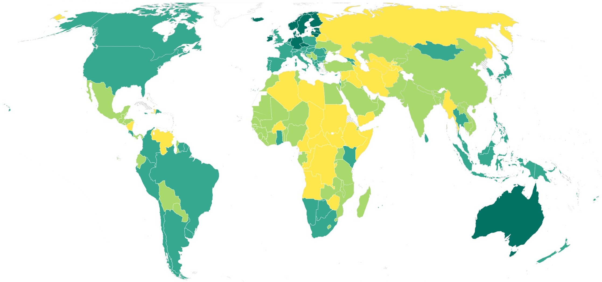

<!-- import externals -->
<head>
<link rel="preconnect" href="https://fonts.googleapis.com">
<link rel="preconnect" href="https://fonts.gstatic.com" crossorigin>
<link href="https://fonts.googleapis.com/css2?family=Noto+Sans:ital,wght@0,100..900;1,100..900&family=Nunito+Sans:ital,opsz,wght@0,6..12,200..1000;1,6..12,200..1000&family=PT+Sans:ital,wght@0,400;0,700;1,400;1,700&display=swap" rel="stylesheet">
<link rel="stylesheet" href="style.css">
</head>

<!-- import components -->

```js
import { wsisMap } from "./components/wsisMap.js";
const wsisData = FileAttachment("./data/wsis-mapping.csv").csv();
```

<!-- hero -->
<div class="hero">
  <h1>Perspectives</h1>
  <h2 class="subheader">Analysis, commentaries and opinions.</h2>
</div>

<div class="body-text">

  <p>The Internet Accountability Compass team publishes short-form analysis, commentary on emerging digital governance trends, and updates on the state of Internet accountability worldwide. Entries draw on the data and frameworks underpinning the Compass to shed light on the forces shaping the global digital landscape.</p>

<!-- ─── ENTRY 4 ──────────────────────────────────────────────────── -->

<a class="blog-img-link" href="#using-the-internet-accountability-compass-to-explore-wsis-and-gdc-implementation">
  <div class="blog-img-wrap">
    
  </div>
</a>

<h1 id="using-the-internet-accountability-compass-to-explore-wsis-and-gdc-implementation">Using the Internet Accountability Compass to explore WSIS and GDC implementation</h1>

<span class="blog-date">6 November 2026 · Nils Berglund</span>

The World Summit on the Information Society (WSIS) set out, in 2003 and 2005, a shared vision of a people-centred, inclusive and development-oriented information society, organised around eleven [Action Lines](https://www.itu.int/en/itu-wsis/Pages/ActionLines.aspx) that run from infrastructure and access to the ethical dimensions of digital life. Twenty years on, the [WSIS+20 review](https://unctad.org/system/files/official-document/a_res_80_173_en.pdf) concluded by the UN General Assembly in December 2025 reaffirmed that vision and turned attention to implementation. Action Line facilitators have been asked to prepare result-oriented roadmaps that link each Action Line to relevant Sustainable Development Goal targets and [Global Digital Compact](https://www.un.org/global-digital-compact) commitments, with potential targets, indicators and metrics. The [Partnership on Measuring ICT for Development](https://www.itu.int/en/ITU-D/Statistics/Pages/intlcoop/partnership/followup.aspx) has been asked to review the existing set of ICT indicators and methodologies. Both report to the Commission on Science and Technology for Development in 2027.

The official [WSIS-SDG matrix](https://www.itu.int/net4/wsis/sdg/) and [WSIS-GDC matrix](https://www.itu.int/net4/wsis/stocktaking/Home/WSISGDC) already show how the three frameworks relate to one another at the level of commitments. This page shows where the data brought together in the Internet Accountability Compass can be used to explore to what extent the WSIS vision is being realised in practice, and where the available evidence runs out.

The Compass draws on twelve established global indicators, grouped into four dimensions: connectivity and infrastructure, rights and freedoms, responsibility and sustainability, and trust and resilience. Each category below opens with the core question it speaks to and what the Compass indicators can tell us about it, lists the Action Lines and WSIS+20 priorities most closely involved, and maps the three indicators to their nearest Action Lines, SDG targets and Global Digital Compact commitments. Each category closes with the open questions that the WSIS process, and the global measurement community more broadly, still needs to answer.

<details class="blog-read-more">
<summary>Read more</summary>

## Connectivity and infrastructure

_Is connectivity available, affordable and usable for everyone, and does access stay open in practice?_

**What we can learn from the compass:** These indicators give a good picture of how far countries have come in extending connectivity and building the conditions to use it well, and whether that connectivity is reliably available when people need it. A country where access is growing while shutdowns recur is making progress on one part of the WSIS vision and falling short on another.

**Main Action Lines:** C2 Information and communication infrastructure; C3 Access to information and knowledge; C4 Capacity building; C6 Enabling environment.

**Related WSIS+20 priorities:** universal, meaningful and affordable connectivity; closing the gender and rural digital divides; public access through schools, libraries, post offices and hospitals; resilient infrastructure; refraining from internet shutdowns and measures that target internet access.

${resize((width) => wsisMap(wsisData, "Connectivity and infrastructure", { width }))}

**Open questions:** connectivity is the best-measured part of the digital agenda, yet the commitments made at WSIS+20 and in the Global Digital Compact ask for more than the current indicators can show. How affordable is a connection relative to what people earn, and is it fast and stable enough to work, study and reach public services? How does access differ between women and men, between cities and rural areas, and for people with disabilities? Are community access points reaching those who would otherwise be offline? Shutdown data record documented disruptions; slower and more selective interference, such as throttling or the blocking of particular services, is harder to detect and rarely counted. Answering these questions may depend on household surveys designed from the outset to capture them, and on the resources and priorities of national statistical systems.

## Rights and freedoms

_Can people exercise their rights and reach information online, and do institutions protect them when they cannot?_

**What we can learn from the compass:** These indicators show whether the rights that WSIS and the Global Digital Compact promise online are protected in practice, and whether the courts, regulators and legal safeguards that people rely on when those rights are violated are functioning. They help separate the adoption of laws from how those laws work for people.

**Main Action Lines:** C3 Access to information and knowledge; C5 Building confidence and security; C6 Enabling environment; C9 Media; C10 Ethical dimensions of the Information Society.

**Related WSIS+20 priorities:** protection of human rights online as offline; freedom of expression and access to information; privacy; media freedom and the safety of journalists; safeguards, oversight and effective remedy; business respect for human rights.

${resize((width) => wsisMap(wsisData, "Rights and freedoms", { width }))}

**Open questions:** rights commitments are among the hardest to measure, and this is where the gap between what states have promised and what can be observed is widest. How do we know whether people who are harmed online can actually obtain a remedy? How can the lawfulness and scale of surveillance be assessed when it is designed to be invisible? What would it take to monitor how platforms moderate content, handle complaints and protect users across different countries? Independent assessments fill part of this gap, but they cover only part of the world and tend to be thinnest where the concerns are greatest, and the broader measures of civil liberties and the rule of law describe the environment in which people go online rather than digital rights themselves. Building rights-sensitive indicators that are credible, comparable and safe to collect is one of the central challenges for the next WSIS cycle.

## Responsibility and sustainability

_Is digital transformation environmentally sustainable, economically inclusive and responsibly governed as new technologies spread?_

**What we can learn from the compass:** These indicators give a sense of whether countries are managing the costs and risks of digital growth alongside its benefits: whether waste is handled responsibly, whether AI is being brought under governance, and whether the rules of the digital economy are open. They broaden the picture of implementation beyond how much digital activity there is to how responsibly it is being pursued.

**Main Action Lines:** C1 Public governance and stakeholder participation; C2 Infrastructure; C6 Enabling environment; C7 ICT applications, in particular e-business and e-environment; C10 Ethical dimensions; C11 International and regional cooperation.

**Related WSIS+20 priorities:** the environmental footprint of digital technologies across their life cycle; e-waste; energy and water demand from data centres and AI; sustainable use of critical minerals; responsible and human-centred AI; fair competition, digital entrepreneurship and participation in the digital economy.

${resize((width) => wsisMap(wsisData, "Responsibility and sustainability", { width }))}

**Open questions:** WSIS+20 gives far more weight to the environmental cost of digitalisation than earlier texts did, and here the data lag well behind the commitments. How can we monitor the energy and water consumed by devices, data traffic, data centres and AI at the level of countries, where policy is made? How can the extraction of critical minerals for digital equipment be tracked? E-waste is measured because a global effort was made to measure it; the rest of the footprint needs the same investment. On AI, the pressing question is how to move from counting strategies and laws to observing how systems are actually deployed, what harms occur and whether people can seek redress. On the digital economy, better data are needed on who participates and who gains, and on the concentration of market power that the Global Digital Compact singles out.

## Trust and resilience

_Can digital systems and public institutions withstand disruption, manage risk and remain accountable to the people they serve?_

**What we can learn from the compass:** These indicators show whether countries have built the capacity to keep digital systems secure and running, and whether the institutions that govern them can be questioned and corrected. Strong cybersecurity and resilience scores alongside weak accountability suggest technical preparedness without the oversight that makes it trustworthy.

**Main Action Lines:** C1 Public governance and stakeholder participation; C2 Infrastructure; C5 Building confidence and security; C6 Enabling environment; C10 Ethical dimensions; C11 International and regional cooperation.

**Related WSIS+20 priorities:** confidence and security in the use of ICTs; consumer trust in the digital economy; resilient infrastructure and services; transparent and predictable regulatory frameworks; accountable institutions and multistakeholder cooperation.

${resize((width) => wsisMap(wsisData, "Trust and resilience", { width }))}

**Open questions:** trust is invoked throughout the WSIS+20 outcome and the Global Digital Compact, and it is one of the hardest things to measure. How much do people actually trust digital services and the institutions behind them, and how does that change after a breach, a shutdown or a disinformation campaign? How many cyber incidents occur, whom do they affect and what do they cost? Are the digital public infrastructure systems now being rolled out for identity, payments and public services safe and subject to meaningful oversight? Current indicators describe preparedness well, and the accountability measures available are general ones; the outcomes that preparedness is meant to secure, and the oversight of digital systems specifically, remain largely unmeasured.

## Interpreting the evidence

The Compass brings together indicators produced by different organisations, using different methods, coverage and reporting years, and the mapping above should be read with that in mind. An indicator can illuminate a WSIS commitment without measuring its implementation directly, and where an indicator is missing for a country this may reflect limited statistical capacity as much as weak performance. The value of the mapping lies in what the indicators show when read together, and in making visible where the global community still lacks the data to know the extent to which digital commitments are being implemented.

_Explore the Internet Accountability Compass by country and category, or read our analysis on data and indicators in the context of the WSIS indicator review._

</details>

<!-- ─── ENTRY 3 ──────────────────────────────────────────────────── -->

<a class="blog-img-link" href="#charting-a-way-for-stronger-internet-accountability">
  <div class="blog-img-wrap">
    
  </div>
</a>

<h1 id="charting-a-way-for-stronger-internet-accountability">Charting a Way for Stronger Internet Accountability</h1>

<span class="blog-date">27 May 2026 · Patryk Pawlak</span>

_Without stronger, measurable accountability, states will keep endorsing open, secure and rights-respecting Internet principles while implementation lags. The Internet Accountability Compass helps close this gap by mapping where data, indicators and institutional capacity exist – and where they do not – to make digital governance commitments enforceable._

## The case for a compass

Over the past decade, governments around the world have endorsed a growing number of commitments aimed at preserving an open, secure, and rights-respecting Internet. International declarations, regional initiatives, and national strategies increasingly recognise that digital networks underpin economic development, democratic participation, and global security. Yet while the normative architecture of Internet governance has expanded significantly, the mechanisms for assessing whether these commitments are implemented remain underdeveloped.

Accountability has emerged as a central challenge of contemporary digital governance. Governments frequently articulate ambitious principles, such as protecting human rights online, ensuring security and resilience, promoting openness and accessibility, but the institutional structures required to monitor, evaluate, and enforce these commitments are often fragmented or incomplete. Reliable indicators are missing in key policy areas, data availability varies significantly across regions and sectors, and enforcement mechanisms tend to rely more on political pressure than on structured oversight.

The Internet Accountability Compass partly addresses these challenges by providing a structured, comparative view of how countries are implementing key digital policy commitments that shape the governance and experience of the Internet. It draws on selected, publicly available datasets and indices to promote transparency, support self-assessment, and enable peer learning, rather than ranking or naming and shaming. But the Compass has also revealed how the persisting structural gaps complicate efforts to determine whether digital governance commitments translate into concrete outcomes. They also unmask deeper questions about the maturity of accountability mechanisms in the Internet ecosystem. Understanding where monitoring is possible, where evidence remains scarce, and where governance capacities are limited is essential for strengthening accountability in practice. In that sense, the Compass allows for several important observations that may guide future policymaking in the digital domain.

<details class="blog-read-more">
<summary>Read more</summary>

## Mismatch between commitments and implementation persists

The Compass highlights a recurring pattern in digital governance: states frequently endorse high-level normative commitments—openness, security, human rights protection, accessibility—but their domestic implementation frameworks lag. This mismatch manifests in several ways, such as formal adoption of digital strategies without adequate institutional resourcing, constitutional protections for human rights online with administrative practices that restrict access or filter content, and commitments to multi-stakeholder engagement without structured participation mechanisms. The Compass makes visible that normative alignment does not necessarily translate into operational alignment. Accountability mechanisms must therefore distinguish between political commitments and practice.

## Data gaps limit monitoring and enforcement

Monitoring mechanisms depend on reliable, comparable indicators. Where data is incomplete, outdated, or methodologically inconsistent, enforcement becomes politically and legally fragile. The absence of systematic reporting in areas such as Internet shutdowns, surveillance authorisations, or algorithmic accountability complicates oversight. Even when civil society produces shadow reports, these are not always harmonised across jurisdictions. As a result, enforcement remains soft—relying on diplomatic pressure, reputational incentives, or peer review rather than formal sanctioning mechanisms. Accountability in the digital domain remains largely political rather than judicial or regulatory.

## Uneven data availability also constrains accountability

Accountability depends on the ability to monitor the commitments undertaken by states, their policies and functioning. This, in turn, means a fundamental reliance on data—and such data is highly uneven across issue areas and regions. In some domains, particularly connectivity, infrastructure deployment, and certain economic indicators, data is relatively robust and standardised. International organisations, telecommunications regulators, and development agencies have produced consistent statistical series. By contrast, in areas such as content moderation practices, state interference, algorithmic governance, surveillance oversight, or procedural safeguards, publicly accessible and comparable data is scarce. Much of the relevant information is either classified, commercially sensitive, or not systematically collected. This asymmetry creates a structural bias: what can be measured shapes what can be evaluated. The Compass therefore demonstrates that accountability gaps are often epistemic before they are political—governments cannot be benchmarked when indicators are underdeveloped or non-existent.

## Some commitment categories lack clear operational indicators

Certain categories of Internet governance commitments remain conceptually clear but operationally vague and may have multiple meanings. Ensuring a safe and secure Internet may refer to cybersecurity resilience, content moderation, child protection, or critical infrastructure defence. Protecting human rights online spans expression, privacy, due process, non-discrimination, and more. Without precise operationalisation, these commitments resist measurable evaluation. The Compass reveals that indicator development is uneven: some dimensions are over-specified (e.g., infrastructure metrics), while others remain normatively dense but empirically thin. This underscores the need for clearer taxonomies and more granular indicator design to avoid conflating rhetorical alignment with measurable compliance.

## Regional context shapes both data and governance outcomes

The Compass demonstrates that regional ecosystems matter significantly. Legal traditions, regulatory cultures, political economies, and levels of digital market concentration vary across regions, influencing both the availability of data and the feasibility of enforcement. In some regions, independent regulatory authorities systematically publish transparency reports and statistical datasets. In others, information flows are centralised within executive structures or fragmented across ministries. Moreover, regional organisations may provide supplementary accountability layers—through peer review, policy harmonisation, or development funding. The Compass thus suggests that global benchmarking must be sensitive to regional governance architectures rather than assuming uniform institutional baselines.

## Capacity is a structural determinant of accountability

The Compass indirectly underscores a fundamental constraint: effective Internet governance is capacity-intensive. States differ significantly in their regulatory expertise, technical infrastructure, budgetary allocation, and inter-agency coordination mechanisms. Where regulatory agencies lack independence or technical capability, even well-intentioned commitments may not materialise in practice. In lower-capacity environments, monitoring compliance, conducting impact assessments, or enforcing digital rights protections may be institutionally unrealistic. This suggests that accountability must be understood not only as a compliance problem but also as a capacity-building challenge. Without strengthening administrative and technical capabilities, benchmarking alone cannot drive convergence.

## Accountability remains largely reactive rather than preventive

Another key insight is that many accountability mechanisms are triggered post hoc—after shutdowns, rights violations, or systemic failures—if at all. Preventive monitoring tools remain underdeveloped. For example, proactive transparency obligations, independent auditing frameworks, and routine rights-impact assessments are not yet universalised practices. Preventive accountability through anticipatory governance tools, rather than merely retrospective reporting, might ultimately improve various dimensions of accountability globally.

## Measurement itself is a governance intervention

The Compass demonstrates that benchmarking is not neutral. By defining categories, selecting indicators, and ranking performance, accountability tools shape policy priorities. States may respond to measurement incentives by strengthening data collection, improving transparency practices, or reforming regulatory frameworks. Conversely, governments may selectively engage in areas that are visible and measurable while neglecting opaque domains. The design of accountability metrics, therefore, carries normative power. Effective monitoring must guard against metric-driven distortions while maintaining comparability and clarity.

## Existing accountability mechanisms remain underutilised

Although Internet governance is often portrayed as lacking enforcement tools, several accountability mechanisms already exist but remain underutilised and unevenly applied. Strengthening accountability, therefore, requires not only new instruments but also better coordination of existing ones. In cybersecurity and digital resilience, enforcement tools are emerging. For example, the European Union’s cyber and human rights sanctions regimes allow asset freezes and travel bans against actors responsible for major cyberattacks or digital rights violations. Regulatory frameworks increasingly include compliance obligations backed by supervisory powers and financial penalties. By contrast, areas such as Internet shutdowns, censorship, surveillance oversight, and algorithmic governance lack comparable mechanisms. Monitoring often depends on civil society and technical networks, while surveillance oversight frequently occurs through opaque, classified procedures.

## Multistakeholder engagement is critical

Accountability in Internet governance cannot be achieved solely by governments. Nor can we expect that governments will implement their international commitments without oversight. The Internet’s architecture and governance structures are inherently multistakeholder. Civil society organisations, research institutions, and technical experts often generate independent data, monitor government behaviour, and identify accountability gaps. In areas where official data is scarce, particularly in regional contexts, civil society monitoring often provides the most reliable evidence. Inclusive multistakeholder participation in data collection and indicator development, therefore, strengthens both the credibility and effectiveness of accountability mechanisms.

## Staying on course towards more accountable internet governance

Accountability in the Internet ecosystem remains a work in progress. Analysis of international instruments and policy areas reveals an important structural reality: enforcement mechanisms tend to emerge first in areas of economic regulation, market governance, or national security, where governments possess stronger regulatory authority and clearer institutional mandates. In contrast, domains that touch directly on political power—such as restrictions on expression, access disruptions, or surveillance—often lack comparable monitoring and enforcement frameworks.

To address the structural gaps identified above, several priorities emerge:

- **Investment in data infrastructure**: Standardised reporting templates, harmonised definitions, and interoperable datasets are prerequisites for comparability.

- **Capacity-building for regulators**: Technical training, institutional independence, and sustainable funding models are essential.

- **Refinement of indicators**: Commitment categories require clearer operational definitions to enable measurable compliance.

- **Regional benchmarking layers**: Complementing global assessment with regionally contextualised monitoring enhances legitimacy and feasibility.

- **Linking measurement to incentives**: Accountability mechanisms must connect benchmarking outputs to diplomatic engagement and reputational incentives.

Ultimately, accountability is not merely about identifying non-compliance; it is about building the informational, institutional, and normative foundations that make compliance observable and enforceable. As the UN Group on the Information Society moves to operationalise joint WSIS–SDG–GDC implementation roadmaps in 2026, tools like the Internet Accountability Compass are positioned to support the monitoring, indicator development, and evidence-based reporting that these roadmaps require. The Internet Governance Forum ecosystem, now a permanent UN platform with more than 150 national and regional forums worldwide, offers a natural venue for the follow-up, peer learning, and iterative review these roadmaps will require.

_You can find the full piece [here](https://cadmus.eui.eu/entities/publication/46f93875-d1df-4d1c-b698-39514f03c691)._

</details>

<!-- ─── ENTRY 2 ──────────────────────────────────────────────────── -->

<a class="blog-img-link" href="#from-promises-to-practice-the-real-test-of-global-digital-cooperation">
  <div class="blog-img-wrap">
    
  </div>
</a>

<h1 id="from-promises-to-practice-the-real-test-of-global-digital-cooperation">From Promises to Practice: The Real Test of Global Digital Cooperation</h1>

<span class="blog-date">27 May 2026 · Patryk Pawlak and Nils Berglund</span>

_In this joint EUI interview, Patryk Pawlak and Nils Berglund discuss the gap between commitment and implementation in global digital cooperation, the outcomes of the WSIS+20 review, and the role of research and the multistakeholder community in making accountability work._

In December 2025, governments concluded a significant review of global digital cooperation, known as the WSIS+20 review, at the UN General Assembly. It was a test of whether the World Summit on the Information Society (WSIS) – a process launched by the United Nations in 2003, where states came together to develop a shared framework for governing the digital transformation – still works in a world where the Internet has become a critical enabler of economic growth, as well as a source of risks to the safety and security of its users. At stake were questions about the future of the Internet Governance Forum (IGF), how WSIS relates to newer initiatives such as the Global Digital Compact (GDC), and whether governments would reaffirm a multistakeholder approach amid rising digital authoritarianism and ideological differences over how to regulate the Internet.

As the Internet and digital technologies continue to reshape economies, societies, and geopolitics, we talked with Part-time Professor Patryk Pawlak and Project Lead Nils Berglund, who deliver the Global Initiative on the Future of the Internet project at the Robert Schuman Centre for Advanced Studies, about the outcomes of the review and the most pressing concern: have states delivered on their commitment to use the Internet as a transformative force working for the benefit of all people?

<details class="blog-read-more">
<summary>Read more</summary>

## What is your assessment of WSIS+20?

**Patryk Pawlak**: The WSIS+20 outcome document, adopted by consensus, delivered more than many expected. It made the Internet Governance Forum a permanent platform of the United Nations and explicitly links it to a multistakeholder vision of Internet governance. States also agreed on a new implementation architecture. The UN Group on the Information Society will present a joint WSIS-Global Digital Compact implementation roadmap in 2026, while WSIS Action Line facilitators will develop more detailed roadmaps that link WSIS Action Lines to Sustainable Development Goals and Global Digital Compact commitments. A biennial reporting cycle for WSIS implementation has been formalised, and dedicated workstreams on indicators and measurement have been established. These decisions send a significant signal of continuity and commitment in a turbulent geopolitical environment.

Strengthening multistakeholder engagement in global digital governance processes is one of the key goals of the Global Initiative on the Future of the Internet project. Our team followed this process closely and convened a series of multistakeholder dialogues around the WSIS+20 review process in Geneva, New York, and Brussels to bring research and civil society perspectives into the debate. For us, the most important shift is that WSIS is no longer only about principles. With roadmaps, targets, and indicators now on the table, implementation and accountability have moved to the centre of global digital cooperation, and this is where research and evidence become essential.

**The WSIS+20 outcome reaffirms the vision of a free and open Internet. But how does that vision square with the reality on the ground, where Internet freedom has been declining?**

**Nils Berglund**: There is a clear tension between the values that states sign up to in New York and Geneva and the policies many of them pursue at home. On paper, the WSIS+20 outcome, the Global Digital Compact, and the Declaration for the Future of the Internet all commit governments to an open, global, interoperable, reliable, and secure Internet that upholds human rights. In practice, Freedom House’s Freedom on the Net 2025 report recorded the 15th consecutive year of global decline in Internet freedom, with conditions worsening in dozens of countries. Internet shutdowns and other forms of network disruption are increasingly used to stifle protests, control elections, and silence critics, with at least 130 shutdown incidents documented across 27 countries in 2025 alone.

A particularly worrying trend is the way governments are targeting the tools that people rely on to keep the Internet open in restrictive environments. Recent developments in Iran are a good illustration of how governments can abuse digital tools to control populations and restrict freedoms. In our project report Tunnel Vision: Anti-Censorship Tools, End-to-End Encryption, and the Fight for a Free and Open Internet, produced with Freedom House, we show that anti-censorship tools like VPNs have been blocked in at least 21 of the 72 countries surveyed, and end-to-end encrypted platforms in at least 17. All of these cases are in countries rated Not Free or Partly Free, and they are often accompanied by criminalisation of VPN use, app store takedowns, and other measures that attack the infrastructure of circumvention itself. These practices sit very uneasily with the commitments to a free and open Internet that the same governments endorse in multilateral fora.

**Patryk Pawlak**: With a view to the WSIS+20 outcome, this gap between principle and practice is where implementation and accountability come in. The question is no longer only whether we can agree on high-level language about openness and rights, but whether we can build mechanisms that make it costly for states to dismantle, restrict, or undermine the tools that keep that vision alive.

**Since implementation is now the focus, how can one evaluate whether states are living up to their digital governance commitments?**

**Nils Berglund**: This is one of the most critical and underdeveloped areas in global digital governance. The WSIS+20 outcome document is significant because it begins to address this, mandating implementation roadmaps with targets, indicators and metrics, and commissioning a systematic review of ICT measurement methodologies by the Partnership on Measuring ICT for Development, reporting to the Commission on Science and Technology for Development (CSTD) in 2027. But the reality is that we are still far from having a coherent monitoring infrastructure that can track whether the principles endorsed in the WSIS outcome or the Global Digital Compact are being translated into action at the national level.

**Patryk Pawlak**: Several gaps stand out. First, there is a data gap: many commitments in these frameworks – on digital inclusion, Internet openness, cybersecurity, or multistakeholder participation – lack agreed-upon indicators, making systematic comparisons across countries difficult. Second, there is an institutional gap, as the various monitoring and reporting mandates are spread across multiple UN bodies, with no single body being responsible for pulling them into a coherent picture. Lastly, there is an accountability gap: even when data exists, there are few mechanisms to hold states accountable when they fall short of their commitments.

**What is the role of the academic community – including the EUI – in closing these gaps?**

**Patryk Pawlak**: Our project’s contribution to addressing some of these governance challenges is the Internet Accountability Compass. It is an interactive online tool that draws on multiple global indexes and datasets to assess how effectively countries are implementing the principles enshrined in the Global Digital Compact and the Declaration for the Future of the Internet. We developed the first version in dialogue with stakeholders at events such as RightsCon 2025 in Taipei and launched it publicly at the Internet Accountability Forum in Brussels.

**Nils Berglund**: As the international community turns to operationalising the WSIS–SDG–GDC roadmaps, we think there is potential to further develop the Compass as a contribution to the broader WSIS implementation monitoring infrastructure, helping to identify precisely where the gaps between commitment and practice are widest, and where targeted interventions could have the greatest impact. We are currently expanding the dataset and the information we provide to make the Compass even more relevant in the future.

**And what role can the multistakeholder community play in strengthening accountability and supporting the implementation of WSIS+20?**

**Nils Berglund**: One of the clearest messages from WSIS+20 is that multistakeholder participation is a core ingredient of effective digital governance. Making the IGF permanent within the UN architecture sends a strong signal that governments recognise the value of having technical experts, companies, civil society, and academia at the table when digital policy is discussed, even if there are disagreements about how far that participation should extend into formal decision-making.

As implementation moves forward, the multistakeholder community can contribute in several practical ways. It can generate and share evidence on what is happening on the ground, from Internet shutdowns to the impacts of AI systems and content-moderation regimes, for example. It can help design and test indicators, targets, and tools that make sense in practice. And it can provide spaces where different actors can collectively stress test ideas, surface unintended consequences, and build the trust needed to translate global commitments into national reforms.

**Patryk Pawlak**: In our own work, we have tried to create such spaces. The Internet Accountability Forum we convened in Brussels in October 2025 brought together policymakers, companies, researchers, and civil society from different regions to discuss disinformation, algorithmic accountability, Internet freedom, and digital resilience, and to explore how an emerging tool like the Internet Accountability Compass could support more evidence-based debates.

The strength of these conversations lies not in everyone agreeing, but in having the right people in the room to confront trade-offs openly and to identify where cooperation is still possible despite geopolitical tensions.

You can read the full piece [here](https://www.eui.eu/news-hub?id=from-promises-to-practice-the-real-test-of-global-digital-cooperation).

</details>

<!-- ─── ENTRY 1 ──────────────────────────────────────────────────── -->

<a class="blog-img-link" href="#regional-contributions-to-global-internet-accountability-debates">
  <div class="blog-img-wrap">
    
  </div>
</a>

<h1 id="regional-contributions-to-global-internet-accountability-debates">Regional Contributions to Global Internet Accountability Debates</h1>

<span class="blog-date">27 May 2026 · Nils Berglund</span>

_As digital governance moves from principle-setting to implementation, global benchmarks and indicators are set to increasingly shape investment priorities, regulatory trends and diplomatic engagements. Ensuring the integration of regional evidence and locally grounded expertise will be critical for the credibility of these efforts._

## Introduction

The gap between the language of commitment—where states pledge to uphold an open, free, and secure internet in line with human rights obligations—and the reality of policy practice has made accountability a central theme in digital governance debates. The WSIS+20 Review outcome has made monitoring and measurement a formal priority, with new indicator review processes underway and a systematic assessment of existing ICT measurement methodologies due by 2027.

Yet the data infrastructure, the interpretive expertise, and the institutional mechanisms underlying such indicators and methodologies are often disproportionately shaped by global-level assumptions and lack regional context and nuance. Bridging this gap requires treating regional approaches not as secondary inputs, but as foundational building blocks of any credible accountability architecture.

<details class="blog-read-more">
<summary>Read more</summary>

## When global benchmarks obscure local realities

Measuring accountability against global benchmarks risks telling more about the geography of available data than the diversity of governance realities. Turning political, legal, and social dynamics into numerical indicators requires compressing complex governance environments into standardised variables. As research on global governance indicators has shown, such metrics can produce knowledge that appears objective while stripping away the contextual meaning that gives the underlying phenomena their significance. The result is not necessarily inaccurate data, but data that can be difficult to interpret without regional expertise.

Definitions that appear straightforward at the global level can therefore become misleading in practice. Access and connectivity benchmarks, for example, have historically obscured the vast difference between minimal, intermittent use and the kind of safe, productive, affordable connectivity that enables meaningful participation in the digital economy and society. In regions like Sub-Saharan Africa, many users hold multiple SIM cards for affordability or network-reliability reasons, which can significantly inflate headline penetration figures relative to the number of actual subscribers. Much of this data is also not disaggregated by gender: the ITU data indicates that 64% of low- and lower-middle-income countries have not reported gender-disaggregated data on ICT indicators since 2020. The growing international push toward universal and meaningful connectivity explicitly recognises this gap. However, many benchmarks still rely on flawed or minimalistic metrics that, for instance, treat a single login within a three-month window as ‘access’.

Structural imbalances in the production of knowledge further complicate the problem. The institutions, datasets, and policy communities that shape global digital governance debates remain concentrated in selected regions, and knowledge produced in languages other than English is routinely absent from the evidence bases that underpin international comparisons. These dynamics can extend into the digital infrastructure itself. Analyses of large language model training data show that the material used to train many systems is heavily concentrated in English and Chinese, leaving other linguistic contexts significantly underrepresented. As AI-assisted tools are increasingly used to monitor compliance, detect network disruptions, and flag governance risks, the linguistic composition of training data becomes a governance question. If the evidence base, the research pipeline, and the tooling are linguistically narrow, the data will reflect these structural asymmetries.

## Data deserts and blind spots

The data gaps underlying global internet accountability are structural rather than incidental. In many regions, particularly across parts of Africa and the Asia–Pacific, the datasets used in global comparisons remain incomplete, inconsistent, or outdated. Core indicators such as internet access, affordability, or digital skills often rely on national statistical offices, telecommunications regulators, or survey-based estimates. Where statistical capacity is limited, global datasets may rely on modelled estimates rather than observed data, creating an appearance of precision even where reliable underlying information is scarce. The International Telecommunication Union’s Measuring Digital Development reports and the work of the Partnership on Measuring ICT for Development have repeatedly highlighted these persistent gaps in official statistics across large parts of the Global South.

Government self-reporting, while useful, has its weaknesses too. Where governments have incentives to demonstrate progress on digital development, the definitions, survey methods, and data they supply are not always transparent or comparable. Independent measurement initiatives—such as OONI and NetBlocks for monitoring network disruptions and censorship—have expanded over the years. Still, their coverage remains uneven and often depends on volunteer measurement nodes, civil society participation and external funding. The contexts where independent data is hardest to collect are frequently those where accountability concerns are greatest.

Quantitative indicators also cannot capture many of the dynamics that matter most for accountability. Political pressure on platforms, the genuine independence of civil society organisations, the chilling effects of surveillance, or the practical ability of citizens to seek redress when rights are violated are often inherently context-dependent questions. Assessments like Freedom House’s Freedom on the Net address this by combining comparative indicators with expert analysis and qualitative country reporting across some 70 countries. Still, the granularity and regional sensitivity of even the most established indices remain limited by data availability, language access, and the resources and interpretive frameworks of their producers. Where key governance dynamics are inherently qualitative, accountability frameworks that rely solely on quantitative scores risk systematically missing what they are supposed to measure.

## Regional frameworks as building blocks

Several regions have created their own instruments and policy architectures that shape accountability expectations, but these are often insufficiently integrated into global comparisons. Such regional governance frameworks are also often more advanced than national practice. In Africa, the AU Data Policy Framework, endorsed in February 2022, provides a continental blueprint for harmonised data governance, drawing on thirty years of experience in coordinating official statistics and seeking to create a trusted environment for cross-border data flows across the continent. The Malabo Convention on cybersecurity and personal data protection entered into force in June 2023 and has since been ratified by nineteen AU member states, establishing a regional legal architecture in a domain where many countries still lack comprehensive national legislation.

In the Asia–Pacific region, the APEC Cross-border Privacy Enforcement Arrangement (CPEA) system provides a mechanism for certifying companies’ compliance with shared data protection standards, creating a regional accountability structure for cross-border data transfers and an interoperability mechanism that has recently expanded into the Global CBPR Forum. ASEAN has also developed a growing set of digital governance frameworks, including the ASEAN Cybersecurity Cooperation Strategy and the ASEAN Guide on AI Governance and Ethics, which articulate regional approaches to cybersecurity resilience, risk management, and responsible AI deployment. These examples are not always captured in global benchmarking exercises or national ICT indicators, but nevertheless establish policy baselines and technical and legal frameworks that constitute an important part of the global accountability infrastructure.

Equally important are regional initiatives that generate independent evidence on digital rights and governance practices. Paradigm Initiative’s Londa Reports and The Score Index, for example, analyse the state of digital rights across twenty-nine African countries, based on a country’s compliance with key human rights elements outlined in the African Commission on Human and Peoples’ Rights Declaration of Principles on Freedom of Expression and Access to Information. Such initiatives provide the type of context-sensitive information that global indices often struggle to capture, including the implementation of laws, the behaviour of regulatory authorities, and the experiences of civil society and journalists operating within national digital environments.

In Asia, Latin America, and Africa, organisations such as LIRNEasia, DIRSI, and Research ICT Africa have produced datasets on connectivity, affordability, and digital policy through initiatives like the After Access surveys, which collect nationally representative data across multiple countries in the Global South. These initiatives demonstrate how regional research networks can complement global measurement efforts by generating datasets and policy analysis that reflect local market structures, regulatory traditions, and social conditions.

Multistakeholder governance platforms provide another important layer of accountability infrastructure. Regional and national Internet Governance Forums (IGFs) have expanded significantly over the past decade, and more than 150 national, regional, and youth IGFs now operate worldwide. Evidence from these platforms shows that they are producing policy-relevant knowledge, feeding into global consultation processes, and building multistakeholder capacity at a scale that global forums alone cannot achieve. If global institutions want accountability through indicators and implementation roadmaps, these regional platforms should be treated as evidence-producing networks rather than outreach audiences.

## Toward a layered accountability architecture

Ultimately, closing the regional gap in internet accountability requires a structural shift in how accountability is designed, who participates in producing the evidence, and how regional knowledge is weighted. In practice, this would mean maintaining global benchmarks and baselines while being transparent about their limitations, incorporating regionally sourced indicators, frameworks, and instruments alongside global ones, and embedding qualitative analysis where data is thin or where context is decisive for interpretation. It also means investing in the infrastructure that enables regional data production, including funding, translation capacity, local research partnerships, and feedback loops that connect regional debates to global measurement cycles.

_You can read the full piece [here](https://cadmus.eui.eu/entities/publication/46f93875-d1df-4d1c-b698-39514f03c691)._

</details>

</div>

```js
{
  document.querySelectorAll(".blog-toc").forEach((el) => el.remove());
  document.querySelectorAll(".toc-toggle-button").forEach((el) => el.remove());

  const toc = document.createElement("nav");
  toc.className = "blog-toc";

  const heading = document.createElement("p");
  heading.className = "blog-toc-heading";
  heading.textContent = "Contents";
  toc.appendChild(heading);

  const list = document.createElement("ul");

  document.querySelectorAll(".body-text h1[id]").forEach((h1) => {
    let next = h1.nextElementSibling;
    while (next && !next.querySelector(".blog-date")) {
      next = next.nextElementSibling;
    }
    const dateText = next
      ? next.querySelector(".blog-date").textContent.trim()
      : "";

    const li = document.createElement("li");
    const link = document.createElement("a");
    link.href = `#${h1.id}`;

    const titleSpan = document.createElement("span");
    titleSpan.className = "blog-toc-title";
    titleSpan.textContent = h1.textContent;

    const dateSpan = document.createElement("span");
    dateSpan.className = "blog-toc-date";
    dateSpan.textContent = dateText;

    link.appendChild(titleSpan);
    link.appendChild(dateSpan);
    li.appendChild(link);
    list.appendChild(li);
  });

  toc.appendChild(list);
  document.body.appendChild(toc);

  // Mobile: surface the ToC via a toggle button in the sticky top bar.
  // The top bar is created by sidebar(), which may render after this cell,
  // so poll briefly until it shows up in the DOM.
  if (window.innerWidth <= 768) {
    let attempts = 0;
    const attachTocToggle = () => {
      const topBar = document.querySelector(".mobile-top-bar");
      if (!topBar) {
        if (++attempts < 50) requestAnimationFrame(attachTocToggle);
        return;
      }
      if (topBar.querySelector(".toc-toggle-button")) return;

      const tocToggle = document.createElement("button");
      tocToggle.className = "toc-toggle-button";
      tocToggle.setAttribute("aria-label", "Toggle table of contents");
      tocToggle.innerHTML = `<svg width="1em" height="1em" viewBox="0 0 24 24" fill="none" stroke="currentColor" stroke-width="1.75" stroke-linecap="round" aria-hidden="true" focusable="false" style="vertical-align:-0.125em"><path d="M9 6h11M9 12h11M9 18h11M4 6h.01M4 12h.01M4 18h.01"/></svg> Contents`;
      tocToggle.addEventListener("click", () => {
        toc.classList.toggle("toc-open");
      });
      topBar.appendChild(tocToggle);
    };
    attachTocToggle();
  }
}
```
